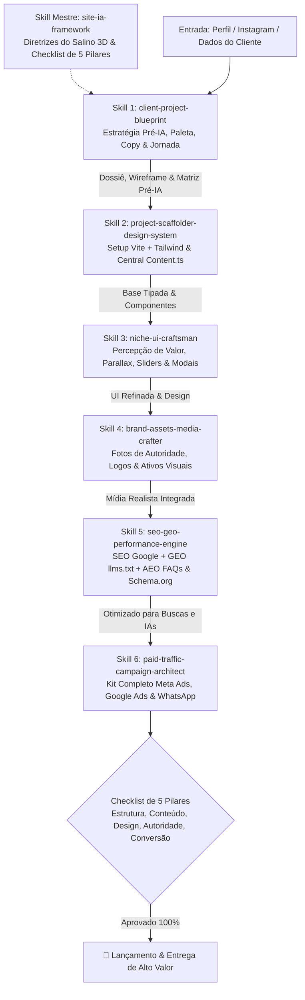

# 🚀 TM FRAMEWORK 2.0 — Framework Site Code Caller (Salino 3D + TM Edition)
### *Metodologia Oficial de Produção Contínua de Sites Institucionais, Landing Pages de Alta Conversão, SEO/GEO/AEO & Tráfego Pago no Antigravity*

> *"A IA não substitui visão, estrutura e posicionamento. Ela acelera a execução. Mas o que faz um site performar é o conjunto: Estratégia, Estrutura, Design, SEO, GEO e AEO."* — **@salino3d**

---

## 📌 Visão Geral do Framework 2.0

O **Framework Site Code Caller (TM FRAMEWORK 2.0)** unifica a esteira técnica do Antigravity com o framework metodológico do **Salino 3D**. Ele estabelece uma barreira rigorosa contra páginas genéricas ou amadoras geradas por IA:

1. **A Estratégia Começa ANTES da IA**: Nenhuma ferramenta é aberta sem antes preencher os 4 Fundamentos (Objetivo, ICP, USP e Ação Esperada).
2. **Estrutura Canônica de Jornada**: O visitante é conduzido sem ruído pelo funil visual de 7 blocos.
3. **Design de Percepção de Valor**: Tipografia profissional, contraste nítido, micro-interações de nicho e mobile impecável.
4. **Dominância nos Mecanismos de Busca & IA**:
   - **SEO**: Palavras-chave de intenção no Google.
   - **GEO**: Otimização para LLMs generativas (`llms.txt`).
   - **AEO**: Respostas diretas e objetivas para perguntas em motores de IA (ChatGPT, Perplexity, Gemini).
5. **Quality Gate Obrigatório**: O projeto só é considerado entregue após passar pelo **Checklist Oficial de 5 Pilares**.

---

## 🗺️ Esteira Oficial de Skills (Pipeline Atualizada)

---

## 🔢 Detalhamento das Skills & Comandos de Ativação

### 👑 Skill Mestre: `site-ia-framework`
* **Função**: Metodologia mestre do Salino 3D, guia estratégico e auditoria de qualidade.
* **Quando usar**: No início do projeto para planejar a estratégia, ou em qualquer momento para auditar e garantir que o site segue os 5 pilares fundamentais.
* **Como Ativar no Chat**:
  > *Ative a skill site-ia-framework para planejar a estratégia pré-IA e estruturar a jornada do nosso novo cliente.*

---

### 1️⃣ Skill 1: `client-project-blueprint`
* **Função**: Diagnóstico pré-IA (Matriz dos 4 Fundamentos: Objetivo, ICP, Proposta de Valor e Ação), Inteligência Competitiva, Paleta de Cores e Wireframe Canônico.
* **Entregáveis**:
  - Dossiê completo do cliente (`dossie-[cliente].md`).
  - Matriz Pré-IA preenchida.
  - Paleta de cores com HEX e tipografia selecionada.
  - Wireframe de 7 blocos estruturado.
* **Como Ativar no Chat**:
  > *Ative a skill client-project-blueprint. Aqui estão as informações e o link do Instagram do cliente: [colar dados / link].*

---

### 2️⃣ Skill 2: `project-scaffolder-design-system`
* **Função**: Inicialização do Código-Fonte, Setup do Design System e Central de Conteúdo Tipada.
* **Stack Padrão**: React + Vite + TypeScript + Tailwind CSS + Lucide React + Framer Motion.
* **Entregáveis**:
  - `tailwind.config.js` com os tokens de cores da marca.
  - Central de copy e dados em `src/data/content.ts` (nenhum texto fixo no JSX).
  - Esqueleto completo dos blocos da jornada (Navbar, Hero, SocialProof, Services, CTA, FAQ, Footer, FloatingWhatsApp).
  - Build verificado rodando a 100% sem erros de TypeScript.
* **Como Ativar no Chat**:
  > *Ative a skill project-scaffolder-design-system para inicializar a base do projeto baseando-se no Dossiê da Skill 1.*

---

### 3️⃣ Skill 3: `niche-ui-craftsman`
* **Função**: Direção de Arte & Percepção de Valor (Anti-Bare) — Transforma templates básicos em experiências de luxo.
* **Entregáveis**:
  - **Logo Tipográfico Nobre**: Criação de marca com tipografia nobre + badge de nicho.
  - **Hero em Camadas**: Foto de autoridade com iluminação radial e badges flutuantes de prova social (`5.0 ★ no Google`).
  - **Componentes Interativos de Nicho**:
    - *Parallax de Autoridade*: Scroll suave na imagem do especialista.
    - *BeforeAfterSlider.tsx*: Comparador interativo de Antes & Depois.
    - *Lookbook & Marquee Ticker*: Fitas infinitas de resultados e logos.
  - **Header & Footer Profundos**: Glassmorphism e footer informativo completo.
* **Como Ativar no Chat**:
  > *Ative a skill niche-ui-craftsman para aplicar a direção de arte do nicho, o logo tipográfico premium, o parallax na foto de autoridade e o polimento visual de luxo.*

---

### 4️⃣ Skill 4: `brand-assets-media-crafter`
* **Função**: Criação, Curadoria e Injeção de Ativos Visuais e Fotos Realistas com IA.
* **Entregáveis**:
  - Fotos de alta resolução geradas ou tratadas para catálogo de serviços e hero banner.
  - Componente de Logo modular (`Logo.tsx`) com variantes para fundo claro e escuro.
  - Texturas sutis de fundo, malhas de gradiente e miniaturas para o rodapé.
* **Como Ativar no Chat**:
  > *Ative a skill brand-assets-media-crafter para gerar e preencher todas as fotos de procedimentos faltantes, banners do Hero e o pack visual completo do projeto.*

---

### 5️⃣ Skill 5: `seo-geo-performance-engine`
* **Função**: SEO Tradicional (Google/Bing) + GEO (Otimização para LLMs generativas) + AEO (Answer Engine Optimization) + Performance Core Web Vitals.
* **Entregáveis**:
  - `public/robots.txt` (permissões para robôs do Google e IAs: GPTBot, PerplexityBot, ClaudeBot).
  - `public/sitemap.xml` (mapa de URLs prioritárias).
  - `public/llms.txt` e `public/llms-full.txt` (resumo padronizado do negócio para IAs generativas).
  - **AEO & FAQ Estruturado**: Perguntas com respostas diretas no primeiro parágrafo para responder a buscas por voz e assistentes de IA.
  - **Schema.org JSON-LD**: Marcação rica de `LocalBusiness`, `AggregateRating`, `Service` e `FAQPage`.
  - Tags de SEO Local e utilitário de captura dinâmica de UTMs para WhatsApp e formulários.
* **Como Ativar no Chat**:
  > *Ative a skill seo-geo-performance-engine para gerar os arquivos robots.txt, sitemap.xml, llms.txt, os esquemas Schema.org JSON-LD e configurar as respostas de AEO e rastreamento.*

---

### 6️⃣ Skill 6: `paid-traffic-campaign-architect`
* **Função**: Estratégia de Mídia Paga e Criação do Kit Completo de Anúncios de Lançamento (Meta Ads & Google Ads).
* **Entregáveis**:
  - **Meta Ads**: 5 anúncios estruturados (Dor, Prova Social, Oferta de Entrada, Roteiro de Reels 9:16 e Carrossel).
  - **Google Ads**: Palavras-chave exatas e de frase, lista de negativas e anúncio responsivo de alta CTR.
  - **Roteiro de Atendimento no WhatsApp**: Script de fechamento rápido para a equipe do cliente.
  - Dossiê da campanha: `campanha-trafego-[cliente].md`.
* **Como Ativar no Chat**:
  > *Ative a skill paid-traffic-campaign-architect para ler todo o projeto e gerar o plano completo de campanhas de tráfego pago no Meta Ads e Google Ads com todas as copies e palavras-chave.*

---

## 🛡️ O Quality Gate: Checklist Oficial de 5 Pilares

Antes de apresentar o site final ao cliente ou publicar em produção, verifique:

- [ ] **1. Estrutura**: A navegação é clara e sem atrito? O visitante chega ao CTA principal em menos de 5 segundos?
- [ ] **2. Conteúdo**: A headline resume a transformação? As dúvidas mais comuns e objeções foram respondidas no FAQ?
- [ ] **3. Design**: A hierarquia visual guia o olhar? A tipografia e as cores passam confiança? O mobile está 100% fluido e sem quebras?
- [ ] **4. Autoridade**: Há números expressivos (+120 clientes, +6 anos), fotos de autoridade legítimas e notas do Google?
- [ ] **5. Conversão**: O botão de WhatsApp/agendamento está visível, com mensagem personalizada e parâmetros UTM funcionando?

---

## 🛠️ Passo a Passo para Iniciar um Novo Projeto no Antigravity

1. **Criar a Pasta do Cliente**: Crie a pasta do projeto (ex: `projetos/clinica-aurora`).
2. **Abrir no Antigravity**: Abra a pasta como workspace.
3. **Executar a Sequência**:
   - Rodar a **Skill 1** (`client-project-blueprint`) preenchendo a Matriz Pré-IA do Salino.
   - Rodar sequencialmente da **Skill 2** até a **Skill 6**.
   - Rodar a auditoria final com a **Skill Mestre** (`site-ia-framework`) conferindo o **Checklist de 5 Pilares**.
