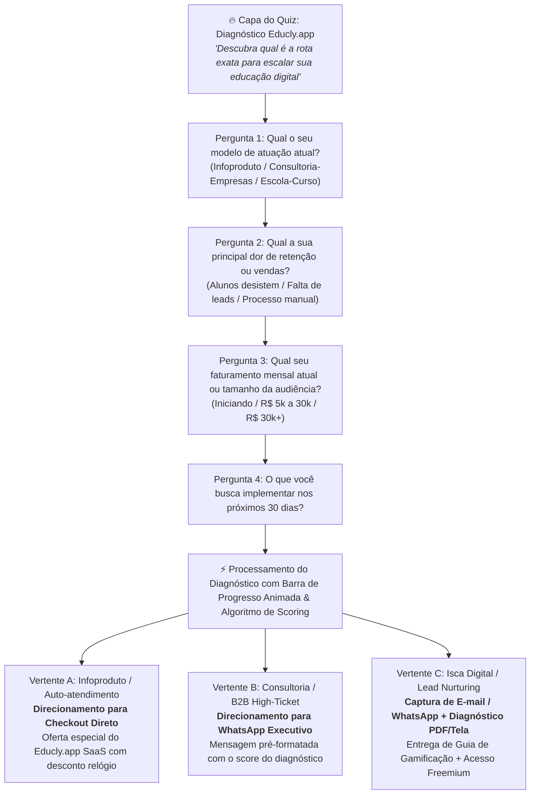

# 📘 Dossiê de Negócio Executivo: Educly.app SaaS & Arquitetura de Funis de Quiz

> **Classificação:** Documento Estratégico & Engenharia de Conversão  
> **Produto:** **Educly.app** — Plataforma SaaS de Aprendizagem, Engajamento e Monetização Educacional  
> **Autor:** Antigravity / TM Sempre Tecnologia  
> **Data:** Setembro de 2026  

---

## 1. 🏢 Dossiê do Negócio: O que é o Educly.app SaaS

### 1.1 Proposta de Valor Central
O **Educly.app** posiciona-se no mercado como uma plataforma SaaS moderna desenhada para resolver o maior gargalo do ecossistema educacional digital contemporâneo: **baixo engajamento dos alunos e atrito na monetização de cursos e treinamentos corporativos/individuais.**

Enquanto as plataformas LMS tradicionais (Hotmart Club, Kiwify, Moodle) oferecem apenas repositórios passivos de vídeos, o **Educly.app** integra:
1. **Aprendizagem Ativa e Interativa com Micro-cliques:** Quiz gamificado, flashcards, testes adaptativos em tempo real e trilhas dinâmicas.
2. **Onboarding Guiado por Diagnóstico:** O aluno ou cliente entra através de um teste de nivelamento instantâneo que personaliza sua jornada de estudo ou recomenda o plano ideal.
3. **Mecanismo de Retenção e Conclusão:** Gamificação nativa com streaks, pontuação e recompensas imediatas que multiplicam a taxa de conclusão de cursos (que no mercado tradicional raramente passa de 12%).

---

### 1.2 Segmentação de Mercado & ICP (Perfil de Cliente Ideal)

O Educly.app atende três pilares estratégicos de clientes:

| Pilar / ICP | Descrição | Dor Principal | Oferta Educly.app |
| :--- | :--- | :--- | :--- |
| **Pilar 1: Criadores de Conteúdo & Infoprodutores** | Produtores digitais, professores particulares e mentores. | Alunos compram mas não assistem às aulas; alto índice de reembolso e churn. | Experiência de curso dinâmica com quiz, comunidade e emissão de certificados imediatos. |
| **Pilar 2: B2B Corporativo & Treinamentos High-Ticket** | Escolas, consultorias e empresas médias que treinam equipes. | Falta de métricas reais de retenção de conhecimento e plataformas corporativas burocráticas. | Dashboard gerencial de desempenho, relatórios por colaborador e trilhas corporativas fechadas. |
| **Pilar 3: Escolas Livres & Preparatórios (Concursos/Vestibulares)** | Cursos de idiomas, reforço escolar, certificações técnicas. | Dificuldade em simular provas e gerar diagnósticos rápidos para captação de novos alunos. | Banco de questões interativo com simulados inteligentes e geração de leads via quiz de nivelamento. |

---

### 1.3 Modelo de Monetização SaaS

1. **Plano Starter (Criadores Iniciantes):** R$ 97 / mês  
   - Até 100 alunos ativos, 5 trilhas de quiz, checkout integrado.
2. **Plano Pro / Growth (Infoprodutores & Escolas):** R$ 197 a R$ 297 / mês *(Plano Âncora)*  
   - Alunos ilimitados, personalização White-Label completa (cores, domínio próprio), inteligência de diagnósticos e webhook para CRM.
3. **Plano Enterprise / Corporate:** R$ 797+ / mês ou sob consulta  
   - Múltiplas contas de equipe, suporte dedicado, exportação SCORM/API e onboarding customizado.

---

## 2. 🎯 Arquitetura da Tríade de Funis de Quiz (3 Vertentes de Conversão)

Conforme a estratégia definida, o funil em **HTML5 + CSS3 + JS Vanilla puro** atende simultaneamente às 3 vertentes de conversão do mercado através de um seletor dinâmico ou de 3 ramificações de saída:

---

## 3. 🛠️ Especificação de Engenharia Frontend (Vanilla Ultra-Performante)

1. **Zero Dependências Pesadas:**
   - Construção em arquivo único ou pacote modular estático (`index.html`, `style.css`, `app.js`).
   - Carregamento instantâneo (Time-to-Interactive < 0.3s) com pontuação 100/100 no Lighthouse.
2. **Design System & Visual Language:**
   - Tipografia de alta autoridade: `Plus Jakarta Sans` para UI e `Newsreader` para manchetes de impacto, com acentos de dados em `JetBrains Mono`.
   - Paleta: Dark Tech & Electric Indigo (Fundo Slate Profundo `#0B0F19`, Cards em Glassmorphism sutil `#111827`, Acento Cyan/Índigo `#4F46E5` / `#06B6D4` e Verde de Conversão `#10B981`).
   - Micro-interações: Barra de progresso dinâmica com preenchimento em tempo real, transição suave entre perguntas sem recarregar a tela, feedback tátil nos cliques de opção.
3. **Mecanismo de Scoring & Roteamento Inteligente:**
   - O usuário pode testar livremente qualquer um dos 3 desfechos (Checkout, WhatsApp ou Lead Magnet) ou navegar pelo algoritmo automático que decide a vertente com base nas respostas.
   - Mensagem do WhatsApp gerada dinamicamente:
     > *"Olá! Acabei de fazer o diagnóstico no Educly.app com perfil [Infoprodutor / Corporativo], meu maior desafio é [Retenção] e quero agendar a demonstração executiva."*
   - Redirecionamento de checkout com parâmetros UTM preservados.
